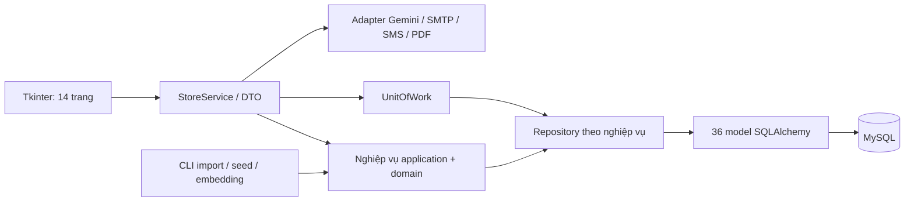

# Kiến trúc

- `ui` dựng widget, thu nhận đầu vào, gọi `StoreService` và hiển thị dữ liệu. UI không mở SQLAlchemy session hay gọi commit/rollback. Các tác vụ nền dùng executor; callback được đưa về luồng Tkinter.
- `application/contracts.py` định nghĩa request/result DTO. API `StoreService` nhận factory tạo UnitOfWork và adapter; `_StoreOperations` điều phối quy tắc nghiệp vụ. Model ORM dùng trong application/database, không trả trực tiếp cho UI.
- `domain` chứa enum và các hàm chính sách thuần. Repository trong `infrastructure/database/repositories` thực hiện truy vấn, ghi và `flush`; khóa `FOR UPDATE` của giao dịch và đặt trước được giữ trong truy vấn.
- `infrastructure/database/models` có một module cho mỗi bảng; `models/__init__.py` đăng ký đầy đủ metadata. `base.py`, `session.py`, `unit_of_work.py`, `setup.py` và `seed.py` phụ trách nền tảng database.
- `bootstrap.build_application` tạo service và các adapter. Các lệnh trong `scripts` là entrypoint của use case import TMDB, seed demo và tạo embedding.

## Transaction và dữ liệu trả về

Mỗi phương thức công khai của `StoreService` tạo một UnitOfWork và session riêng. Các bước bên trong cùng một nghiệp vụ dùng chung session; thành công commit, ngoại lệ rollback và luôn đóng session. Trước khi đóng session, dữ liệu cho UI được chuyển thành DTO, bao gồm thông tin tài khoản/nhân viên/vai trò, ca, khách hàng, phim và phiếu.

Đăng nhập ghi audit ngay cả khi không thành công; đề cử có thể ghi cache. Tạo mock ghi fixture một transaction rồi commit riêng từng ngày. Import TMDB commit checkpoint sau mỗi trang; seed demo commit sau mỗi 500 phiếu; tạo embedding commit mỗi 25 vector mới. Xuất PDF tạo file trước rồi ghi audit bằng một lời gọi riêng.

`StoreService` chỉ cung cấp interface nội bộ của ứng dụng; đường dẫn import và constructor cũ không được duy trì như một lớp tương thích. API tạo/cập nhật trả `RecordView` khi màn hình chỉ cần ID; các màn hình đọc thông tin dùng DTO chi tiết tương ứng.
