# Cơ sở dữ liệu và model

Metadata SQLAlchemy đăng ký 36 bảng; mỗi class nằm trong một module riêng dưới `src/normastore/infrastructure/database/models`. Các bảng, cột, kiểu, giá trị mặc định, khóa và index bên dưới được trích từ metadata của code. `PK` là khóa chính, `FK` là khóa ngoại, `UQ` là duy nhất; `NULL` cho phép rỗng. Default Python là giá trị hoặc hàm phía ứng dụng, không nhất thiết là default phía MySQL.

Alembic sử dụng cùng metadata, với các revision từ `20260903_01` đến `20260907_04`. Hạn chế khi nâng cấp một database trống được ghi trong [vận hành và kiểm thử](operations-testing.md#giới-hạn-migration-đã-xác-nhận).

## Quan hệ

Sơ đồ thể hiện khóa ngoại; tính duy nhất của khóa và các index được liệt kê chi tiết sau sơ đồ.

```mermaid
erDiagram
    audit_logs {
        int id PK
    }
    catalog_items {
        int id PK
    }
    combo_items {
        int combo_id PK
        int item_id PK
    }
    combos {
        int id PK
    }
    content_embeddings {
        int id PK
    }
    copy_status_history {
        int id PK
    }
    customers {
        int id PK
    }
    deposit_defaults {
        string media_format PK
    }
    employees {
        int id PK
    }
    external_reviews {
        int id PK
    }
    genres {
        int id PK
    }
    import_runs {
        int id PK
    }
    item_genres {
        int item_id PK
        int genre_id PK
    }
    mock_daily_runs {
        int id PK
    }
    notification_outbox {
        int id PK
    }
    order_discounts {
        int id PK
    }
    order_lines {
        int id PK
    }
    orders {
        int id PK
    }
    payment_transactions {
        int id PK
    }
    penalty_charges {
        int id PK
    }
    physical_copies {
        int id PK
    }
    premium_memberships {
        int id PK
    }
    recommendation_cache {
        int id PK
    }
    rental_extensions {
        int id PK
    }
    rental_terms {
        int id PK
    }
    reputation_events {
        int id PK
    }
    reservations {
        int id PK
    }
    return_lines {
        int id PK
    }
    return_receipts {
        int id PK
    }
    roles {
        int id PK
    }
    sale_returns {
        int id PK
    }
    seasons {
        int id PK
    }
    shifts {
        int id PK
    }
    shows {
        int id PK
    }
    user_accounts {
        int id PK
    }
    vouchers {
        int id PK
    }
    employees o|--o{ audit_logs : actor_id
    seasons o|--o{ catalog_items : season_id
    shows o|--o{ catalog_items : show_id
    combos ||--o{ combo_items : combo_id
    catalog_items ||--o{ combo_items : item_id
    shows o|--o{ combos : show_id
    catalog_items ||--o| content_embeddings : item_id
    employees o|--o{ copy_status_history : actor_id
    physical_copies ||--o{ copy_status_history : copy_id
    employees o|--o{ deposit_defaults : updated_by
    catalog_items o|--o{ external_reviews : item_id
    shows o|--o{ external_reviews : show_id
    genres ||--o{ item_genres : genre_id
    catalog_items ||--o{ item_genres : item_id
    employees o|--o{ mock_daily_runs : actor_id
    customers ||--o{ notification_outbox : customer_id
    rental_terms o|--o{ notification_outbox : rental_term_id
    orders ||--o{ order_discounts : order_id
    physical_copies o|--o{ order_lines : copy_id
    orders ||--o{ order_lines : order_id
    order_lines o|--o{ order_lines : source_rental_line_id
    customers ||--o{ orders : customer_id
    employees ||--o{ orders : employee_id
    shifts o|--o{ orders : shift_id
    customers ||--o{ payment_transactions : customer_id
    employees o|--o{ payment_transactions : employee_id
    orders o|--o{ payment_transactions : order_id
    rental_terms ||--o{ penalty_charges : rental_term_id
    catalog_items ||--o{ physical_copies : item_id
    customers ||--o{ premium_memberships : customer_id
    customers o|--o{ recommendation_cache : customer_id
    employees ||--o{ rental_extensions : employee_id
    rental_terms ||--o{ rental_extensions : rental_term_id
    order_lines ||--o| rental_terms : line_id
    employees o|--o{ reputation_events : actor_id
    customers ||--o{ reputation_events : customer_id
    physical_copies o|--o{ reservations : allocated_copy_id
    customers ||--o{ reservations : customer_id
    catalog_items ||--o{ reservations : item_id
    return_receipts ||--o{ return_lines : receipt_id
    rental_terms ||--o{ return_lines : rental_term_id
    customers ||--o{ return_receipts : customer_id
    employees ||--o{ return_receipts : employee_id
    employees ||--o{ sale_returns : employee_id
    order_lines ||--o{ sale_returns : sale_line_id
    shows ||--o{ seasons : show_id
    employees ||--o{ shifts : employee_id
    employees ||--o| user_accounts : employee_id
    roles ||--o{ user_accounts : role_id
```

## Bảng và cột

### `audit_logs` ? `AuditLog`

Mô-đun: `normastore.infrastructure.database.models.audit_log`

| Cột | Kiểu MySQL | Ràng buộc / giá trị mặc định |
|---|---|---|
| `id` | `INTEGER` | NOT NULL; PK |
| `actor_id` | `INTEGER` | NULL; FK -> employees.id |
| `action` | `VARCHAR(100)` | NOT NULL |
| `entity` | `VARCHAR(100)` | NOT NULL |
| `entity_id` | `VARCHAR(100)` | NOT NULL |
| `detail` | `JSON` | NULL |
| `created_at` | `DATETIME` | NOT NULL; Python default: utcnow() |

Ràng buộc / chỉ mục: `INDEX ix_audit_logs_action_created (action, created_at)`; `INDEX ix_audit_logs_actor_created (actor_id, created_at)`; `INDEX ix_audit_logs_created_at (created_at)`.

### `catalog_items` ? `CatalogItem`

Mô-đun: `normastore.infrastructure.database.models.catalog_item`

| Cột | Kiểu MySQL | Ràng buộc / giá trị mặc định |
|---|---|---|
| `id` | `INTEGER` | NOT NULL; PK |
| `item_type` | `ENUM('MOVIE','EPISODE')` | NOT NULL |
| `tmdb_id` | `INTEGER` | NULL |
| `title` | `VARCHAR(255)` | NOT NULL |
| `overview` | `TEXT` | NULL |
| `release_date` | `DATE` | NULL |
| `runtime_minutes` | `INTEGER` | NULL |
| `vote_average` | `NUMERIC(4, 2)` | NULL |
| `certification` | `VARCHAR(30)` | NULL |
| `poster_path` | `VARCHAR(500)` | NULL |
| `rental_price` | `NUMERIC(14, 2)` | NOT NULL; Python default: 25000 |
| `sale_price` | `NUMERIC(14, 2)` | NOT NULL; Python default: 200000 |
| `deposit_amount` | `NUMERIC(14, 2)` | NOT NULL; Python default: 150000 |
| `replacement_value` | `NUMERIC(14, 2)` | NOT NULL; Python default: 250000 |
| `can_rent` | `BOOL` | NOT NULL; Python default: True |
| `can_sell` | `BOOL` | NOT NULL; Python default: True |
| `show_id` | `INTEGER` | NULL; FK -> shows.id |
| `season_id` | `INTEGER` | NULL; FK -> seasons.id |
| `episode_number` | `INTEGER` | NULL |
| `archived` | `BOOL` | NOT NULL; Python default: False |
| `created_at` | `DATETIME` | NOT NULL; Python default: utcnow() |
| `updated_at` | `DATETIME` | NOT NULL; Python default: utcnow(); Python on update: utcnow() |

Ràng buộc / chỉ mục: `UNIQUE uq_catalog_item_type_tmdb (item_type, tmdb_id)`; `INDEX ix_catalog_item_title (title)`; `INDEX ix_catalog_show_episode (show_id, season_id, episode_number)`.

### `combo_items` ? `ComboItem`

Mô-đun: `normastore.infrastructure.database.models.combo_item`

| Cột | Kiểu MySQL | Ràng buộc / giá trị mặc định |
|---|---|---|
| `combo_id` | `INTEGER` | NOT NULL; PK; FK -> combos.id |
| `item_id` | `INTEGER` | NOT NULL; PK; FK -> catalog_items.id |

Ràng buộc / chỉ mục: `PRIMARY KEY (combo_id, item_id)`.

### `combos` ? `Combo`

Mô-đun: `normastore.infrastructure.database.models.combo`

| Cột | Kiểu MySQL | Ràng buộc / giá trị mặc định |
|---|---|---|
| `id` | `INTEGER` | NOT NULL; PK |
| `name` | `VARCHAR(160)` | NOT NULL |
| `rule_type` | `VARCHAR(40)` | NOT NULL; Python default: FIXED |
| `discount_amount` | `NUMERIC(14, 2)` | NOT NULL; Python default: 0 |
| `show_id` | `INTEGER` | NULL; FK -> shows.id |
| `required_count` | `INTEGER` | NULL |
| `active` | `BOOL` | NOT NULL; Python default: True |
| `created_at` | `DATETIME` | NOT NULL; Python default: utcnow() |
| `updated_at` | `DATETIME` | NOT NULL; Python default: utcnow(); Python on update: utcnow() |

Ràng buộc / chỉ mục: ?.

### `content_embeddings` ? `ContentEmbedding`

Mô-đun: `normastore.infrastructure.database.models.content_embedding`

| Cột | Kiểu MySQL | Ràng buộc / giá trị mặc định |
|---|---|---|
| `id` | `INTEGER` | NOT NULL; PK |
| `item_id` | `INTEGER` | NOT NULL; UQ; FK -> catalog_items.id |
| `model` | `VARCHAR(80)` | NOT NULL |
| `dimensions` | `INTEGER` | NOT NULL |
| `vector` | `BLOB` | NOT NULL |
| `source_hash` | `VARCHAR(64)` | NOT NULL |
| `created_at` | `DATETIME` | NOT NULL; Python default: utcnow() |
| `updated_at` | `DATETIME` | NOT NULL; Python default: utcnow(); Python on update: utcnow() |

Ràng buộc / chỉ mục: `UNIQUE (unnamed) (item_id)`.

### `copy_status_history` ? `CopyStatusHistory`

Mô-đun: `normastore.infrastructure.database.models.copy_status_history`

| Cột | Kiểu MySQL | Ràng buộc / giá trị mặc định |
|---|---|---|
| `id` | `INTEGER` | NOT NULL; PK |
| `copy_id` | `INTEGER` | NOT NULL; FK -> physical_copies.id |
| `from_status` | `ENUM('AVAILABLE','HELD','RENTED','INSPECTION','REPAIR','LOST','SOLD','RETIRED')` | NULL |
| `to_status` | `ENUM('AVAILABLE','HELD','RENTED','INSPECTION','REPAIR','LOST','SOLD','RETIRED')` | NOT NULL |
| `note` | `VARCHAR(500)` | NULL |
| `actor_id` | `INTEGER` | NULL; FK -> employees.id |
| `created_at` | `DATETIME` | NOT NULL; Python default: utcnow() |

Ràng buộc / chỉ mục: ?.

### `customers` ? `Customer`

Mô-đun: `normastore.infrastructure.database.models.customer`

| Cột | Kiểu MySQL | Ràng buộc / giá trị mặc định |
|---|---|---|
| `id` | `INTEGER` | NOT NULL; PK |
| `full_name` | `VARCHAR(160)` | NOT NULL |
| `phone` | `VARCHAR(30)` | NOT NULL; UQ |
| `email` | `VARCHAR(255)` | NULL |
| `address` | `VARCHAR(255)` | NULL |
| `reputation_score` | `INTEGER` | NOT NULL; Python default: 80 |
| `email_opt_in` | `BOOL` | NOT NULL; Python default: True |
| `sms_opt_in` | `BOOL` | NOT NULL; Python default: True |
| `created_at` | `DATETIME` | NOT NULL; Python default: utcnow() |
| `updated_at` | `DATETIME` | NOT NULL; Python default: utcnow(); Python on update: utcnow() |

Ràng buộc / chỉ mục: `UNIQUE (unnamed) (phone)`.

### `deposit_defaults` ? `DepositDefault`

Mô-đun: `normastore.infrastructure.database.models.deposit_default`

| Cột | Kiểu MySQL | Ràng buộc / giá trị mặc định |
|---|---|---|
| `media_format` | `VARCHAR(20)` | NOT NULL; PK |
| `amount` | `NUMERIC(14, 2)` | NOT NULL |
| `updated_by` | `INTEGER` | NULL; FK -> employees.id |
| `created_at` | `DATETIME` | NOT NULL; Python default: utcnow() |
| `updated_at` | `DATETIME` | NOT NULL; Python default: utcnow(); Python on update: utcnow() |

Ràng buộc / chỉ mục: ?.

### `employees` ? `Employee`

Mô-đun: `normastore.infrastructure.database.models.employee`

| Cột | Kiểu MySQL | Ràng buộc / giá trị mặc định |
|---|---|---|
| `id` | `INTEGER` | NOT NULL; PK |
| `full_name` | `VARCHAR(160)` | NOT NULL |
| `phone` | `VARCHAR(30)` | NULL |
| `active` | `BOOL` | NOT NULL; Python default: True |
| `created_at` | `DATETIME` | NOT NULL; Python default: utcnow() |
| `updated_at` | `DATETIME` | NOT NULL; Python default: utcnow(); Python on update: utcnow() |

Ràng buộc / chỉ mục: ?.

### `external_reviews` ? `ExternalReview`

Mô-đun: `normastore.infrastructure.database.models.external_review`

| Cột | Kiểu MySQL | Ràng buộc / giá trị mặc định |
|---|---|---|
| `id` | `INTEGER` | NOT NULL; PK |
| `item_id` | `INTEGER` | NULL; FK -> catalog_items.id |
| `show_id` | `INTEGER` | NULL; FK -> shows.id |
| `tmdb_review_id` | `VARCHAR(100)` | NOT NULL; UQ |
| `author` | `VARCHAR(160)` | NULL |
| `rating` | `NUMERIC(4, 2)` | NULL |
| `content` | `TEXT` | NOT NULL |
| `published_at` | `DATETIME` | NULL |
| `created_at` | `DATETIME` | NOT NULL; Python default: utcnow() |
| `updated_at` | `DATETIME` | NOT NULL; Python default: utcnow(); Python on update: utcnow() |

Ràng buộc / chỉ mục: `UNIQUE (unnamed) (tmdb_review_id)`.

### `genres` ? `Genre`

Mô-đun: `normastore.infrastructure.database.models.genre`

| Cột | Kiểu MySQL | Ràng buộc / giá trị mặc định |
|---|---|---|
| `id` | `INTEGER` | NOT NULL; PK |
| `name` | `VARCHAR(80)` | NOT NULL; UQ |

Ràng buộc / chỉ mục: `UNIQUE (unnamed) (name)`.

### `import_runs` ? `ImportRun`

Mô-đun: `normastore.infrastructure.database.models.import_run`

| Cột | Kiểu MySQL | Ràng buộc / giá trị mặc định |
|---|---|---|
| `id` | `INTEGER` | NOT NULL; PK |
| `provider` | `VARCHAR(30)` | NOT NULL |
| `kind` | `VARCHAR(30)` | NOT NULL |
| `status` | `VARCHAR(30)` | NOT NULL; Python default: RUNNING |
| `checkpoint` | `JSON` | NULL |
| `imported_count` | `INTEGER` | NOT NULL; Python default: 0 |
| `error` | `TEXT` | NULL |
| `created_at` | `DATETIME` | NOT NULL; Python default: utcnow() |
| `updated_at` | `DATETIME` | NOT NULL; Python default: utcnow(); Python on update: utcnow() |

Ràng buộc / chỉ mục: ?.

### `item_genres` ? `ItemGenre`

Mô-đun: `normastore.infrastructure.database.models.item_genre`

| Cột | Kiểu MySQL | Ràng buộc / giá trị mặc định |
|---|---|---|
| `item_id` | `INTEGER` | NOT NULL; PK; FK -> catalog_items.id |
| `genre_id` | `INTEGER` | NOT NULL; PK; FK -> genres.id |

Ràng buộc / chỉ mục: `PRIMARY KEY (item_id, genre_id)`.

### `mock_daily_runs` ? `MockDailyRun`

Mô-đun: `normastore.infrastructure.database.models.mock_daily_run`

| Cột | Kiểu MySQL | Ràng buộc / giá trị mặc định |
|---|---|---|
| `id` | `INTEGER` | NOT NULL; PK |
| `business_date` | `DATE` | NOT NULL; UQ |
| `seed_version` | `VARCHAR(40)` | NOT NULL |
| `stats` | `JSON` | NULL |
| `actor_id` | `INTEGER` | NULL; FK -> employees.id |
| `created_at` | `DATETIME` | NOT NULL; Python default: utcnow() |

Ràng buộc / chỉ mục: `UNIQUE (unnamed) (business_date)`.

### `notification_outbox` ? `NotificationOutbox`

Mô-đun: `normastore.infrastructure.database.models.notification_outbox`

| Cột | Kiểu MySQL | Ràng buộc / giá trị mặc định |
|---|---|---|
| `id` | `INTEGER` | NOT NULL; PK |
| `customer_id` | `INTEGER` | NOT NULL; FK -> customers.id |
| `rental_term_id` | `INTEGER` | NULL; FK -> rental_terms.id |
| `channel` | `VARCHAR(20)` | NOT NULL |
| `event` | `VARCHAR(30)` | NOT NULL |
| `scheduled_for` | `DATETIME` | NOT NULL |
| `status` | `ENUM('PENDING','SENT','FAILED','SKIPPED')` | NOT NULL; Python default: PENDING |
| `attempts` | `INTEGER` | NOT NULL; Python default: 0 |
| `error` | `TEXT` | NULL |
| `dedupe_key` | `VARCHAR(255)` | NOT NULL; UQ |
| `created_at` | `DATETIME` | NOT NULL; Python default: utcnow() |
| `updated_at` | `DATETIME` | NOT NULL; Python default: utcnow(); Python on update: utcnow() |

Ràng buộc / chỉ mục: `UNIQUE (unnamed) (dedupe_key)`.

### `order_discounts` ? `OrderDiscount`

Mô-đun: `normastore.infrastructure.database.models.order_discount`

| Cột | Kiểu MySQL | Ràng buộc / giá trị mặc định |
|---|---|---|
| `id` | `INTEGER` | NOT NULL; PK |
| `order_id` | `INTEGER` | NOT NULL; FK -> orders.id |
| `source` | `VARCHAR(30)` | NOT NULL |
| `amount` | `NUMERIC(14, 2)` | NOT NULL |
| `source_code` | `VARCHAR(80)` | NULL |

Ràng buộc / chỉ mục: ?.

### `order_lines` ? `OrderLine`

Mô-đun: `normastore.infrastructure.database.models.order_line`

| Cột | Kiểu MySQL | Ràng buộc / giá trị mặc định |
|---|---|---|
| `id` | `INTEGER` | NOT NULL; PK |
| `order_id` | `INTEGER` | NOT NULL; FK -> orders.id |
| `copy_id` | `INTEGER` | NULL; FK -> physical_copies.id |
| `action` | `ENUM('RENT','BUY','PREMIUM')` | NOT NULL |
| `title_snapshot` | `VARCHAR(255)` | NOT NULL |
| `unit_price` | `NUMERIC(14, 2)` | NOT NULL |
| `discount_amount` | `NUMERIC(14, 2)` | NOT NULL; Python default: 0 |
| `deposit_amount` | `NUMERIC(14, 2)` | NOT NULL; Python default: 0 |
| `source_rental_line_id` | `INTEGER` | NULL; FK -> order_lines.id |

Ràng buộc / chỉ mục: ?.

### `orders` ? `Order`

Mô-đun: `normastore.infrastructure.database.models.order`

| Cột | Kiểu MySQL | Ràng buộc / giá trị mặc định |
|---|---|---|
| `id` | `INTEGER` | NOT NULL; PK |
| `code` | `VARCHAR(30)` | NOT NULL; UQ |
| `customer_id` | `INTEGER` | NOT NULL; FK -> customers.id |
| `employee_id` | `INTEGER` | NOT NULL; FK -> employees.id |
| `shift_id` | `INTEGER` | NULL; FK -> shifts.id |
| `status` | `VARCHAR(30)` | NOT NULL; Python default: CONFIRMED |
| `gross_total` | `NUMERIC(14, 2)` | NOT NULL; Python default: 0 |
| `discount_total` | `NUMERIC(14, 2)` | NOT NULL; Python default: 0 |
| `deposit_total` | `NUMERIC(14, 2)` | NOT NULL; Python default: 0 |
| `created_at` | `DATETIME` | NOT NULL; Python default: utcnow() |
| `updated_at` | `DATETIME` | NOT NULL; Python default: utcnow(); Python on update: utcnow() |

Ràng buộc / chỉ mục: `UNIQUE (unnamed) (code)`; `INDEX ix_order_customer_created (customer_id, created_at)`.

### `payment_transactions` ? `PaymentTransaction`

Mô-đun: `normastore.infrastructure.database.models.payment_transaction`

| Cột | Kiểu MySQL | Ràng buộc / giá trị mặc định |
|---|---|---|
| `id` | `INTEGER` | NOT NULL; PK |
| `order_id` | `INTEGER` | NULL; FK -> orders.id |
| `customer_id` | `INTEGER` | NOT NULL; FK -> customers.id |
| `employee_id` | `INTEGER` | NULL; FK -> employees.id |
| `method` | `ENUM('CASH','BANK_TRANSFER','E_WALLET')` | NOT NULL |
| `category` | `VARCHAR(30)` | NOT NULL |
| `amount` | `NUMERIC(14, 2)` | NOT NULL |
| `note` | `VARCHAR(500)` | NULL |
| `created_at` | `DATETIME` | NOT NULL; Python default: utcnow() |
| `updated_at` | `DATETIME` | NOT NULL; Python default: utcnow(); Python on update: utcnow() |

Ràng buộc / chỉ mục: ?.

### `penalty_charges` ? `PenaltyCharge`

Mô-đun: `normastore.infrastructure.database.models.penalty_charge`

| Cột | Kiểu MySQL | Ràng buộc / giá trị mặc định |
|---|---|---|
| `id` | `INTEGER` | NOT NULL; PK |
| `rental_term_id` | `INTEGER` | NOT NULL; FK -> rental_terms.id |
| `kind` | `VARCHAR(20)` | NOT NULL |
| `amount` | `NUMERIC(14, 2)` | NOT NULL |
| `reason` | `VARCHAR(500)` | NOT NULL |
| `created_at` | `DATETIME` | NOT NULL; Python default: utcnow() |
| `updated_at` | `DATETIME` | NOT NULL; Python default: utcnow(); Python on update: utcnow() |

Ràng buộc / chỉ mục: ?.

### `physical_copies` ? `PhysicalCopy`

Mô-đun: `normastore.infrastructure.database.models.physical_copy`

| Cột | Kiểu MySQL | Ràng buộc / giá trị mặc định |
|---|---|---|
| `id` | `INTEGER` | NOT NULL; PK |
| `item_id` | `INTEGER` | NOT NULL; FK -> catalog_items.id |
| `barcode` | `VARCHAR(80)` | NOT NULL; UQ |
| `media_format` | `VARCHAR(20)` | NOT NULL; Python default: DVD |
| `condition` | `ENUM('NEW','GOOD','WORN','DAMAGED')` | NOT NULL; Python default: GOOD |
| `status` | `ENUM('AVAILABLE','HELD','RENTED','INSPECTION','REPAIR','LOST','SOLD','RETIRED')` | NOT NULL; Python default: AVAILABLE |
| `can_rent` | `BOOL` | NOT NULL; Python default: True |
| `can_sell` | `BOOL` | NOT NULL; Python default: True |
| `rental_price_override` | `NUMERIC(14, 2)` | NULL |
| `sale_price_override` | `NUMERIC(14, 2)` | NULL |
| `deposit_override` | `NUMERIC(14, 2)` | NULL |
| `created_at` | `DATETIME` | NOT NULL; Python default: utcnow() |
| `updated_at` | `DATETIME` | NOT NULL; Python default: utcnow(); Python on update: utcnow() |

Ràng buộc / chỉ mục: `UNIQUE (unnamed) (barcode)`; `INDEX ix_copy_item_status (item_id, status)`.

### `premium_memberships` ? `PremiumMembership`

Mô-đun: `normastore.infrastructure.database.models.premium_membership`

| Cột | Kiểu MySQL | Ràng buộc / giá trị mặc định |
|---|---|---|
| `id` | `INTEGER` | NOT NULL; PK |
| `customer_id` | `INTEGER` | NOT NULL; FK -> customers.id |
| `starts_on` | `DATE` | NOT NULL |
| `ends_on` | `DATE` | NOT NULL |
| `price_paid` | `NUMERIC(14, 2)` | NOT NULL |
| `created_at` | `DATETIME` | NOT NULL; Python default: utcnow() |
| `updated_at` | `DATETIME` | NOT NULL; Python default: utcnow(); Python on update: utcnow() |

Ràng buộc / chỉ mục: ?.

### `recommendation_cache` ? `RecommendationCache`

Mô-đun: `normastore.infrastructure.database.models.recommendation_cache`

| Cột | Kiểu MySQL | Ràng buộc / giá trị mặc định |
|---|---|---|
| `id` | `INTEGER` | NOT NULL; PK |
| `customer_id` | `INTEGER` | NULL; FK -> customers.id |
| `cache_key` | `VARCHAR(160)` | NOT NULL; UQ |
| `item_ids` | `JSON` | NOT NULL |
| `expires_at` | `DATETIME` | NOT NULL |
| `created_at` | `DATETIME` | NOT NULL; Python default: utcnow() |
| `updated_at` | `DATETIME` | NOT NULL; Python default: utcnow(); Python on update: utcnow() |

Ràng buộc / chỉ mục: `UNIQUE (unnamed) (cache_key)`.

### `rental_extensions` ? `RentalExtension`

Mô-đun: `normastore.infrastructure.database.models.rental_extension`

| Cột | Kiểu MySQL | Ràng buộc / giá trị mặc định |
|---|---|---|
| `id` | `INTEGER` | NOT NULL; PK |
| `rental_term_id` | `INTEGER` | NOT NULL; FK -> rental_terms.id |
| `old_due_date` | `DATE` | NOT NULL |
| `new_due_date` | `DATE` | NOT NULL |
| `fee` | `NUMERIC(14, 2)` | NOT NULL |
| `employee_id` | `INTEGER` | NOT NULL; FK -> employees.id |
| `created_at` | `DATETIME` | NOT NULL; Python default: utcnow() |
| `updated_at` | `DATETIME` | NOT NULL; Python default: utcnow(); Python on update: utcnow() |

Ràng buộc / chỉ mục: ?.

### `rental_terms` ? `RentalTerm`

Mô-đun: `normastore.infrastructure.database.models.rental_term`

| Cột | Kiểu MySQL | Ràng buộc / giá trị mặc định |
|---|---|---|
| `id` | `INTEGER` | NOT NULL; PK |
| `line_id` | `INTEGER` | NOT NULL; UQ; FK -> order_lines.id |
| `due_date` | `DATE` | NOT NULL |
| `state` | `ENUM('ACTIVE','RETURNED','PURCHASED','LOST','CANCELLED')` | NOT NULL; Python default: ACTIVE |
| `late_daily_rate` | `NUMERIC(14, 2)` | NOT NULL; Python default: 5000 |
| `issued_condition` | `ENUM('NEW','GOOD','WORN','DAMAGED')` | NOT NULL; Python default: GOOD |
| `returned_on` | `DATE` | NULL |

Ràng buộc / chỉ mục: `UNIQUE (unnamed) (line_id)`; `INDEX ix_rental_due_state (due_date, state)`.

### `reputation_events` ? `ReputationEvent`

Mô-đun: `normastore.infrastructure.database.models.reputation_event`

| Cột | Kiểu MySQL | Ràng buộc / giá trị mặc định |
|---|---|---|
| `id` | `INTEGER` | NOT NULL; PK |
| `customer_id` | `INTEGER` | NOT NULL; FK -> customers.id |
| `delta` | `INTEGER` | NOT NULL |
| `reason` | `VARCHAR(255)` | NOT NULL |
| `actor_id` | `INTEGER` | NULL; FK -> employees.id |
| `created_at` | `DATETIME` | NOT NULL; Python default: utcnow() |
| `updated_at` | `DATETIME` | NOT NULL; Python default: utcnow(); Python on update: utcnow() |

Ràng buộc / chỉ mục: ?.

### `reservations` ? `Reservation`

Mô-đun: `normastore.infrastructure.database.models.reservation`

| Cột | Kiểu MySQL | Ràng buộc / giá trị mặc định |
|---|---|---|
| `id` | `INTEGER` | NOT NULL; PK |
| `customer_id` | `INTEGER` | NOT NULL; FK -> customers.id |
| `item_id` | `INTEGER` | NOT NULL; FK -> catalog_items.id |
| `state` | `ENUM('WAITING','HELD','FULFILLED','EXPIRED','CANCELLED')` | NOT NULL; Python default: WAITING |
| `hold_until` | `DATETIME` | NULL |
| `allocated_copy_id` | `INTEGER` | NULL; FK -> physical_copies.id |
| `created_at` | `DATETIME` | NOT NULL; Python default: utcnow() |
| `updated_at` | `DATETIME` | NOT NULL; Python default: utcnow(); Python on update: utcnow() |

Ràng buộc / chỉ mục: `INDEX ix_reservation_item_state_created (item_id, state, created_at)`.

### `return_lines` ? `ReturnLine`

Mô-đun: `normastore.infrastructure.database.models.return_line`

| Cột | Kiểu MySQL | Ràng buộc / giá trị mặc định |
|---|---|---|
| `id` | `INTEGER` | NOT NULL; PK |
| `receipt_id` | `INTEGER` | NOT NULL; FK -> return_receipts.id |
| `rental_term_id` | `INTEGER` | NOT NULL; FK -> rental_terms.id |
| `outcome` | `VARCHAR(30)` | NOT NULL; Python default: NORMAL |
| `note` | `TEXT` | NULL |

Ràng buộc / chỉ mục: ?.

### `return_receipts` ? `ReturnReceipt`

Mô-đun: `normastore.infrastructure.database.models.return_receipt`

| Cột | Kiểu MySQL | Ràng buộc / giá trị mặc định |
|---|---|---|
| `id` | `INTEGER` | NOT NULL; PK |
| `customer_id` | `INTEGER` | NOT NULL; FK -> customers.id |
| `employee_id` | `INTEGER` | NOT NULL; FK -> employees.id |
| `returned_on` | `DATE` | NOT NULL |
| `created_at` | `DATETIME` | NOT NULL; Python default: utcnow() |
| `updated_at` | `DATETIME` | NOT NULL; Python default: utcnow(); Python on update: utcnow() |

Ràng buộc / chỉ mục: ?.

### `roles` ? `Role`

Mô-đun: `normastore.infrastructure.database.models.role`

| Cột | Kiểu MySQL | Ràng buộc / giá trị mặc định |
|---|---|---|
| `id` | `INTEGER` | NOT NULL; PK |
| `code` | `ENUM('ADMIN','MANAGER','STAFF')` | NOT NULL; UQ |
| `name` | `VARCHAR(80)` | NOT NULL |

Ràng buộc / chỉ mục: `UNIQUE (unnamed) (code)`.

### `sale_returns` ? `SaleReturn`

Mô-đun: `normastore.infrastructure.database.models.sale_return`

| Cột | Kiểu MySQL | Ràng buộc / giá trị mặc định |
|---|---|---|
| `id` | `INTEGER` | NOT NULL; PK |
| `sale_line_id` | `INTEGER` | NOT NULL; FK -> order_lines.id |
| `employee_id` | `INTEGER` | NOT NULL; FK -> employees.id |
| `returned_on` | `DATE` | NOT NULL |
| `refund_amount` | `NUMERIC(14, 2)` | NOT NULL |
| `note` | `TEXT` | NULL |
| `created_at` | `DATETIME` | NOT NULL; Python default: utcnow() |
| `updated_at` | `DATETIME` | NOT NULL; Python default: utcnow(); Python on update: utcnow() |

Ràng buộc / chỉ mục: ?.

### `seasons` ? `Season`

Mô-đun: `normastore.infrastructure.database.models.season`

| Cột | Kiểu MySQL | Ràng buộc / giá trị mặc định |
|---|---|---|
| `id` | `INTEGER` | NOT NULL; PK |
| `show_id` | `INTEGER` | NOT NULL; FK -> shows.id |
| `season_number` | `INTEGER` | NOT NULL |
| `name` | `VARCHAR(255)` | NOT NULL |

Ràng buộc / chỉ mục: `UNIQUE uq_season_show_number (show_id, season_number)`.

### `shifts` ? `Shift`

Mô-đun: `normastore.infrastructure.database.models.shift`

| Cột | Kiểu MySQL | Ràng buộc / giá trị mặc định |
|---|---|---|
| `id` | `INTEGER` | NOT NULL; PK |
| `employee_id` | `INTEGER` | NOT NULL; FK -> employees.id |
| `opened_at` | `DATETIME` | NOT NULL; Python default: utcnow() |
| `closed_at` | `DATETIME` | NULL |
| `opening_cash` | `NUMERIC(14, 2)` | NOT NULL; Python default: 0 |
| `closing_cash` | `NUMERIC(14, 2)` | NULL |
| `created_at` | `DATETIME` | NOT NULL; Python default: utcnow() |
| `updated_at` | `DATETIME` | NOT NULL; Python default: utcnow(); Python on update: utcnow() |

Ràng buộc / chỉ mục: ?.

### `shows` ? `Show`

Mô-đun: `normastore.infrastructure.database.models.show`

| Cột | Kiểu MySQL | Ràng buộc / giá trị mặc định |
|---|---|---|
| `id` | `INTEGER` | NOT NULL; PK |
| `tmdb_id` | `INTEGER` | NULL; UQ |
| `title` | `VARCHAR(255)` | NOT NULL |
| `overview` | `TEXT` | NULL |
| `poster_path` | `VARCHAR(500)` | NULL |
| `vote_average` | `NUMERIC(4, 2)` | NULL |
| `archived` | `BOOL` | NOT NULL; Python default: False |
| `created_at` | `DATETIME` | NOT NULL; Python default: utcnow() |
| `updated_at` | `DATETIME` | NOT NULL; Python default: utcnow(); Python on update: utcnow() |

Ràng buộc / chỉ mục: `UNIQUE (unnamed) (tmdb_id)`.

### `user_accounts` ? `UserAccount`

Mô-đun: `normastore.infrastructure.database.models.user_account`

| Cột | Kiểu MySQL | Ràng buộc / giá trị mặc định |
|---|---|---|
| `id` | `INTEGER` | NOT NULL; PK |
| `employee_id` | `INTEGER` | NOT NULL; UQ; FK -> employees.id |
| `role_id` | `INTEGER` | NOT NULL; FK -> roles.id |
| `username` | `VARCHAR(80)` | NOT NULL; UQ |
| `password_hash` | `VARCHAR(255)` | NOT NULL |
| `must_change_password` | `BOOL` | NOT NULL; Python default: True |
| `created_at` | `DATETIME` | NOT NULL; Python default: utcnow() |
| `updated_at` | `DATETIME` | NOT NULL; Python default: utcnow(); Python on update: utcnow() |

Ràng buộc / chỉ mục: `UNIQUE (unnamed) (username)`; `UNIQUE (unnamed) (employee_id)`.

### `vouchers` ? `Voucher`

Mô-đun: `normastore.infrastructure.database.models.voucher`

| Cột | Kiểu MySQL | Ràng buộc / giá trị mặc định |
|---|---|---|
| `id` | `INTEGER` | NOT NULL; PK |
| `code` | `VARCHAR(50)` | NOT NULL; UQ |
| `percent_off` | `NUMERIC(5, 2)` | NULL |
| `amount_off` | `NUMERIC(14, 2)` | NULL |
| `starts_on` | `DATE` | NULL |
| `ends_on` | `DATE` | NULL |
| `active` | `BOOL` | NOT NULL; Python default: True |
| `created_at` | `DATETIME` | NOT NULL; Python default: utcnow() |
| `updated_at` | `DATETIME` | NOT NULL; Python default: utcnow(); Python on update: utcnow() |

Ràng buộc / chỉ mục: `UNIQUE (unnamed) (code)`.
